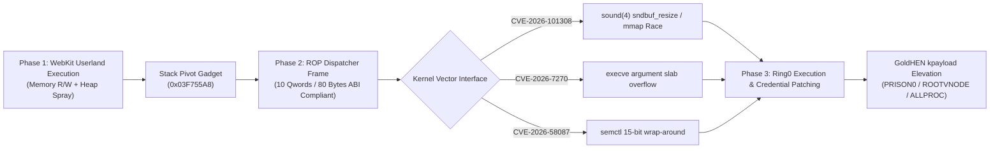

# PS4 Firmware 14.00 Technical Research Notes

**Snapshot Date:** October 26, 2026  
**Lead Researcher:** Adrián García Casado (`@adri22235`)  
**Research Entity:** García Casado Security Research (García Casado Cyber Lab)  
**Primary Repository:** [adri22235/ps4-13xx-research](https://github.com/adri22235/ps4-13xx-research)  
**Target Scope:** PlayStation 4 Orbis OS Firmware 14.00 (Build Release: September 16, 2026)  
**Compliance Standard:** ISO/IEC 29147 (Coordinated Vulnerability Disclosure) & ISO/IEC 30111  

---

## 1. Executive Technical Summary

Firmware 14.00 represents a critical demarcation point within the PlayStation 4 system architecture. Disclosed on September 16, 2026, it immediately preceded the emergency security maintenance rollout of Firmware 14.10 on October 1, 2026.

Current research state:
* **Userland Execution (WebKit):** Native execution and arbitrary read/write capability within the `libSceNKWebKit.sprx` browser process have been established. Flow control gadgets have been extracted and mapped with an empirically verified `+0x4000` delta relative to Firmware 13.50.
* **Sandbox Confinement:** WebKit execution remains isolated by Orbis OS process sandbox boundaries, specifically under non-`AF_UNIX` socket creation restrictions introduced in recent kernel revisions.
* **Kernel Attack Surface:** Following the remediation of filesystem-based entry points (such as Celsius), post-exploitation and ring0 privilege escalation focus on unpatched kernel sub-systems derived from FreeBSD, notably `sound(4)` race primitives and System V IPC interfaces.

---

## 2. Firmware 14.00 Exploit Architecture

The three-stage technical execution pipeline for Firmware 14.00 research is structured as follows:

---

## 3. WebKit Binary Analysis (`libSceNKWebKit.sprx`)

* **Target Binary:** `libSceNKWebKit.sprx.decrypted` (FW 14.00)
* **File Size:** 70,255,992 bytes (67.0 MB)
* **Architecture Delta:** Uniform `+0x4000` (16 KB) base shift in `.text` flow-control gadgets relative to Firmware 13.50.
* **Extraction Tooling:** Gadget extraction is fully automated and reproducible via [`scripts/find_webkit_gadgets_1400.py`](https://github.com/adri22235/ps4-13xx-research/blob/main/scripts/find_webkit_gadgets_1400.py).
* **Legal Compliance:** In strict adherence to copyright laws and Sony Interactive Entertainment terms (DMCA), proprietary decrypted binaries are never hosted in public repositories. Gadgets are reproduced by running the extraction toolchain against legally obtained firmware dumps.

### Verified Gadget Map (29 ROP Gadgets)

| Identifier | Offset (FW 14.00) | Offset (FW 13.50) | Delta | Instruction / Semantic Function |
| :--- | :--- | :--- | :--- | :--- |
| `wk_RET` | `0x00004032` | `0x03cbc51b` | Relocated | `ret` (Alignment / Trampoline) |
| `wk_LEAVE_RET` | `0x0001c2f7` | `0x000182f7` | `+0x4000` | `leave; ret` |
| `wk_POP_RAX_RET` | `0x00014504` | `0x00010504` | `+0x4000` | `pop rax; ret` (Syscall number / Return) |
| `wk_POP_RBX_RET` | `0x0000b9e8` | `0x000079e8` | `+0x4000` | `pop rbx; ret` |
| `wk_POP_RCX_RET` | `0x0001fade` | `0x0001bade` | `+0x4000` | `pop rcx; ret` (Argument 4 in C ABI) |
| `wk_POP_RDX_RET` | `0x001305ba` | `0x0012c5ba` | `+0x4000` | `pop rdx; ret` (Argument 3) |
| `wk_POP_RSI_RET` | `0x0007245e` | `0x0006e45e` | `+0x4000` | `pop rsi; ret` (Argument 2) |
| `wk_POP_RDI_RET` | `0x00060480` | `0x0005c480` | `+0x4000` | `pop rdi; ret` (Argument 1) |
| `wk_POP_RBP_RET` | `0x000040b6` | `0x03ccc7a2` | Relocated | `pop rbp; ret` |
| `wk_POP_RSP_RET` | `0x00073017` | `0x03cbc51a` | Relocated | `pop rsp; ret` |
| `wk_POP_R8_RET` | `0x0230cbe1` | `0x0005c47f` | Relocated | `pop r8; ret` (Argument 5) |
| `wk_POP_R12_RET` | `0x0242ab15` | `0x02426b15` | `+0x4000` | `pop r12; ret` |
| `wk_POP_R14_RET` | `0x000a9e91` | `0x000a5e91` | `+0x4000` | `pop r14; ret` |
| `wk_POP_R15_RET` | `0x0006047f` | `0x0005c47f` | `+0x4000` | `pop r15; ret` |
| `wk_MOV_RAX_RDI_RET` | `0x00023320` | `0x0001f320` | `+0x4000` | `mov rax, rdi; ret` |
| `wk_MOV_RDX_RAX_RET` | `0x001ceba9` | `0x001caba9` | `+0x4000` | `mov rdx, rax; ret` |
| `wk_XCHG_RAX_RSP_RET` | `0x03f755a8` | `0x03f715a8` | `+0x4000` | `xchg rax, rsp; ret` **(Primary Stack Pivot)** |
| `wk_MOV_QWORD_RDI_RAX_RET`| `0x0000948b` | `0x0000548b` | `+0x4000` | `mov [rdi], rax; ret` **(Arbitrary Write)** |
| `wk_MOV_RAX_QWORD_RAX_RET`| `0x00014021` | `0x00010021` | `+0x4000` | `mov rax, [rax]; ret` **(Arbitrary Read)** |
| `wk_MOV_RAX_QWORD_RDI_RET`| `0x000e2ea0` | `0x000deea0` | `+0x4000` | `mov rax, [rdi]; ret` **(Arbitrary Read)** |
| `wk_ADD_RAX_RCX_RET` | `0x00084f67` | `0x00080f67` | `+0x4000` | `add rax, rcx; ret` |
| `wk_SUB_RAX_RCX_RET` | `0x0098736c` | `0x0098336c` | `+0x4000` | `sub rax, rcx; ret` |
| `wk_XOR_RAX_RAX_RET` | `0x023d14f6` | `0x023cd4f6` | `+0x4000` | `xor rax, rax; ret` (Zero RAX) |
| `wk_INC_RAX_RET` | `0x00c5e51c` | `0x00c5a51c` | `+0x4000` | `inc rax; ret` |
| `wk_JMP_RAX` | `0x00004082` | `0x00004082` | `0x0000` | `jmp rax` |
| `wk_CALL_RAX` | `0x00004041` | `0x00004041` | `0x0000` | `call rax` |
| `wk_JMP_RCX` | `0x00012a2a` | `0x0000ea2a` | `+0x4000` | `jmp rcx` |
| `wk_POP_R13_R14_R15_RET` | `0x0006047b` | `0x0005c47b` | `+0x4000` | `pop r13; pop r14; pop r15; ret` |
| `wk_POP_RBX_RBP_RET` | `0x0000ad0f` | `0x00006d0f` | `+0x4000` | `pop rbx; pop rbp; ret` |

---

## 4. ROP Dispatcher Specification & ABI Compliance

The ROP dispatch mechanism is modeled and verified in [`tests/test_rop_dispatcher_1400.c`](https://github.com/adri22235/ps4-13xx-research/blob/main/tests/test_rop_dispatcher_1400.c). It provides a standard 10-qword (80-byte) execution frame designed to prepare register arguments and enforce 16-byte boundary alignment as mandated by the AMD64 ABI.

### Dispatcher Frame Layout

| Index | Element | Register Target / Purpose | Gadget Offset (14.00) |
| :---: | :--- | :--- | :--- |
| `[00]` | `base + GADGET_POP_RDI_RET` | Load Argument 1 | `0x00060480` |
| `[01]` | `arg1` (Immediate 64-bit) | RDI Register | — |
| `[02]` | `base + GADGET_POP_RSI_RET` | Load Argument 2 | `0x0007245E` |
| `[03]` | `arg2` (Immediate 64-bit) | RSI Register | — |
| `[04]` | `base + GADGET_POP_RDX_RET` | Load Argument 3 | `0x001305BA` |
| `[05]` | `arg3` (Immediate 64-bit) | RDX Register | — |
| `[06]` | `base + GADGET_POP_RCX_RET` | Load Argument 4 / Wrapper Target | `0x0001FADE` |
| `[07]` | `arg4` (Immediate 64-bit) | RCX Register | — |
| `[08]` | `base + GADGET_POP_RAX_RET` | Load Syscall ID / Dispatcher | `0x00014504` |
| `[09]` | `syscall_num` (Immediate 64-bit) | RAX Register | — |

### Technical Architecture Notes:
1. **Calling Conventions (System V AMD64 vs Direct Syscall):**
   * **Userspace Wrappers (`libkernel`):** Standard C calling conventions use `RDI`, `RSI`, `RDX`, `RCX`, `R8`, and `R9`. When dispatching through `libkernel.sprx` wrapper stubs, parameter 4 is correctly placed in `RCX`.
   * **Direct Hardware Syscalls:** The x86_64 `syscall` instruction natively clobbers `RCX` (saving return `RIP`) and `R11` (saving `RFLAGS`). The FreeBSD kernel ABI expects parameter 4 in `R10`. For direct kernel traps, the frame passes control through a wrapper or intermediary register move gadget (`mov r10, rcx`).
2. **Stack Alignment Invariant:**
   * Frame size: $10 \times 8 = 80\text{ bytes}$.
   * Alignment check: $80 \pmod{16} = 0$.
   * The frame structure inherently preserves 16-byte stack parity across calls. An auxiliary `ret` gadget (`0x00004032`) is prepended as an alignment shim whenever an entry pivot lands on an odd 8-byte boundary.

---

## 5. Firmware 14.00 Kernel Data Offsets (GoldHEN Standard)

Kernel symbol offsets for Firmware 14.00 have been cataloged for post-exploitation payload integration (`kpayload`):

| Symbol | FW 14.00 Offset | FW 13.04 Offset | Functionality in Ring0 Payload |
| :--- | :--- | :--- | :--- |
| `PRISON0` | `0x0111FA18` | `0x0111FA18` | Root jail context; zeroed to escape sandbox |
| `ROOTVNODE` | `0x02136E90` | `0x02136E90` | Root directory vnode; assigned to `p_fd->fd_rdir` |
| `ALLPROC` | `0x01B28538` | `0x01B28538` | Head of global process linked list (`struct proc`) |
| `SYSENT` | `0x0110A760` | `0x01102B70` | System call dispatch table (`+0x7BF0` delta from 13.04) |
| `XFAST_SYSCALL` | `0x000001C0` | `0x000001C0` | Kernel syscall entry handler |
| `memcpy` | `0x002BD850` | `0x002BD850` | Internal kernel memory copy subroutine |
| `proc_rwmem` | `0x00366A10` | `0x00366A10` | Cross-process memory read/write subroutine |

---

## 6. FreeBSD-Derived Kernel Vulnerability Catalogue

Orbis OS is derived from FreeBSD 9 with proprietary Sony subsystem additions. Recent FreeBSD upstream disclosures (July–October 2026) were released after Firmware 14.00 code freeze:

| Vulnerability | Advisory / Reference | Subsystem | Vulnerability Class & PS4 Assessment |
| :--- | :--- | :--- | :--- |
| **CVE-2026-101308** | [FreeBSD-SA-26:71.sound](https://security.freebsd.org/advisories/FreeBSD-SA-26:71.sound.asc) | `sys/dev/sound/pcm/buffer.c` | **Race / UAF in `mmap`:** `sndbuf_resize` drops channel lock for `M_WAITOK` without revalidating `CHN_F_MMAP`. Fresh patch (Oct 2026); highly relevant to Orbis audio driver. |
| **CVE-2026-7270** | [FreeBSD-SA-26:13.exec](https://lists.freebsd.org/archives/freebsd-security/2026-April/000448.html) | `sys/kern/kern_exec.c` | **Kernel Slab Overflow:** Operator precedence flaw in `exec_args_adjust_args` allows an out-of-bounds copy of $+1024$ bytes into the kernel slab. |
| **CVE-2026-58087** | [FreeBSD-SA-26:54.sysvsem](https://security.freebsd.org/advisories/FreeBSD-SA-26:54.sysvsem.asc) | `sys/kern/sysv_sem.c` | **15-Bit Wrap OOB Read/Write:** TOCTOU in `semctl` `GETALL`/`SETALL` allows sequence counter wrap at 32,768 cycles. Fully intact in FreeBSD 9 core. |
| **CVE-2026-58098** | [FreeBSD-SA-26:64.sysvsem](https://security.freebsd.org/advisories/FreeBSD-SA-26:64.sysvsem.asc) | `sys/kern/sysv_sem.c` | **Heap OOB Access:** Out-of-bounds index calculation in `semop(2)`. Syscall 511 interface accessible. |
| **CVE-2026-45251** | [FreeBSD-SA-26:45.poll](https://security.freebsd.org/advisories/) | `sys/kern/sys_generic.c` | **UAF Race:** Concurrent descriptor closure during `poll(2)`/`select(2)` event registration. Measured race window under 100 $\mu$s. |

---

## 7. Firmware Version Timeline & Scene Context

* **September 16, 2026:** Sony publishes **PS4 Firmware 14.00**. Userland WebKit vulnerabilities remain exploitable with updated gadget offsets.
* **October 1, 2026:** Sony deploys emergency update **Firmware 14.10** across the PlayStation ecosystem, specifically targeting public developments around the *Relapse* AIO chain and *Byepervisor Reborn* hypervisor bypass. Mandatory update enforcement was instituted by cutting PlayStation Network (PSN) connectivity for consoles on earlier revisions.
* **Cross-Platform PS5 Repository:** Detailed architectural analysis of FreeBSD vectors applied to Prospero OS (PS5) and hypervisor bridge specifications are documented at [adri22235/ps5-security-research](https://github.com/adri22235/ps5-security-research).
* **Research Recommendation:** Consoles targeting homebrew or security verification on Firmware 14.00 must remain strictly offline to prevent unwanted automatic updating to 14.10+.

---

## 8. Primary Tooling & Test Harness Inventory

The test harnesses supporting this research are located in the primary research repository:

1. [`scripts/find_webkit_gadgets_1400.py`](https://github.com/adri22235/ps4-13xx-research/blob/main/scripts/find_webkit_gadgets_1400.py) — Automated pattern scanner for `libSceNKWebKit.sprx`.
2. [`scripts/freebsd_vuln_sentinel.py`](https://github.com/adri22235/ps4-13xx-research/blob/main/scripts/freebsd_vuln_sentinel.py) — Upstream FreeBSD kernel commit tracker.
3. [`tests/test_rop_dispatcher_1400.c`](https://github.com/adri22235/ps4-13xx-research/blob/main/tests/test_rop_dispatcher_1400.c) — C harness validating the 10-qword frame, stack pivot, and 16-byte alignment.
4. [`tests/test_semctl_kernel_rw.c`](https://github.com/adri22235/ps4-13xx-research/blob/main/tests/test_semctl_kernel_rw.c) — Simulation of the 15-bit wrap-around primitive for CVE-2026-58087.
5. [`tests/test_cred_root_patch.c`](https://github.com/adri22235/ps4-13xx-research/blob/main/tests/test_cred_root_patch.c) — Memory safety verification of `PRISON0`, `ROOTVNODE`, and `ALLPROC` traversal.
6. [`exploit_1400.html`](https://github.com/adri22235/ps4-13xx-research/blob/main/exploit_1400.html) — Unified WebKit exploit interface and ROP dispatch runner.
